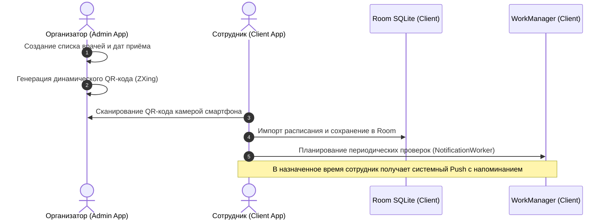

# 🏥 Medical Commission Mobile Suite (Android)

Комплекс нативных Android-приложений для автоматизации, планирования и прохождения медицинских комиссий с поддержкой **офлайн-синхронизации через динамические QR-коды**.

Решение состоит из двух модулей:
1. **Admin / Organizer App (`admin-app`)** — приложение для организатора медкомиссии или регистратуры. Позволяет формировать списки профильных врачей, график приёма, временные слоты и экспортировать конфигурацию комиссии в виде зашифрованного QR-кода.
2. **Client / Employee App (`client-app`)** — приложение для сотрудника или пациента. Сканирует QR-код организатора, автоматически разворачивает персональный план обследования в локальную БД и настраивает фоновые напоминания о визитах.

---

## 🏗 Архитектура и технологии

Оба приложения разработаны в соответствии с рекомендациями **Android Modern Architecture (MAD)**:

| Категория | Технология | Назначение |
|---|---|---|
| **Язык & Платформа** | Java 17, Android SDK (minSdk 24, targetSdk 34) | Нативная разработка |
| **Архитектурный паттерн** | MVVM (Model-View-ViewModel) | Разделение логики, UI и данных |
| **Локальная база данных** | Room ORM (SQLite) | Хранение сущностей (`Doctor`, `MedicalDate`), DAO-интерфейсы |
| **Фоновые задачи** | AndroidX WorkManager (`NotificationWorker`) | Гарантированная доставка push-напоминаний о дедлайнах медосмотра |
| **Офлайн-синхронизация** | ZXing (`QRCodeWriter` / Barcode Scanner) | Генерация и считывание структуры расписания через QR-код |
| **UI & Компоненты** | Material Components for Android | Адаптивная вёрстка, списки (`RecyclerView`, `ListAdapter`) |

---

## 🔄 Схема взаимодействия (Data Flow)

Система полностью автономна и не требует постоянного подключения к интернету:



---

## 📂 Структура проекта

```
medical-commission-mobile-suite/
├── admin-app/                 # Приложение организатора (генератор медкомиссий)
│   ├── src/main/java/com/example/mat/
│   │   ├── AppDatabase.java          # Room Database
│   │   ├── Doctor.java               # Сущность врача (ФИО, кабинет, специальность)
│   │   ├── MedicalDate.java          # Сущность дат прохождения
│   │   ├── AddDoctorActivity.java    # Добавление врача
│   │   ├── ManageDatesActivity.java  # Управление календарём
│   │   └── ExportActivity.java       # Генерация QR-кода расписания
│   └── build.gradle.kts
│
├── client-app/                # Приложение сотрудника (трекер медосмотра)
│   ├── src/main/java/com/example/doch/
│   │   ├── AppDatabase.java          # Локальная база Room
│   │   ├── ImportConfigActivity.java # Скан QR-кода и валидация
│   │   ├── DoctorListActivity.java   # Чек-лист врачей с отметками о прохождении
│   │   └── NotificationWorker.java   # Фоновый воркер системных пушей
│   └── build.gradle.kts
│
└── README.md
```

---

## 🚀 Сборка и запуск

### Требования
* **Android Studio:** Hedgehog (2023.1.1) или новее
* **JDK:** 17+
* **Gradle:** 8.x

### Инструкция:
1. Клонируйте репозиторий:
   ```bash
   git clone https://github.com/<your-username>/medical-commission-mobile-suite.git
   ```
2. Откройте Android Studio.
3. Выберите `File -> Open` и укажите папку `admin-app` или `client-app`.
4. Дождитесь завершения Gradle Sync.
5. Запустите на эмуляторе или физическом устройстве (`Run 'app'`).

---

## 🔐 Безопасность и персональные данные
* Приложения работают по модели **Privacy by Design**: данные хранятся исключительно в изолированном хранилище приложения (App Sandbox / Encrypted SQLite).
* QR-код передаёт только структуру направлений и графики, не требуя передачи личных биометрических данных по открытой сети.

---

## 📄 Лицензия
MIT License.
